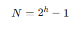

N = 1023    

从而代入N后，h可得10
因此，最坏查找时间oh，10
最大递归深度等于树高，因此为10
辅助空间复杂度主要来自于函数调用栈，因此也是10

完全退化的 BST 本质上变成了一个单链表（每个节点只有左孩子或只有右孩子）。节点总数为1023
最坏查找时间：由于没有分支，查找目标可能需要从头遍历到尾。时间复杂度为O(N)。具体到这里，最多需要比较 1023 次
最大递归深度：递归会一层一层向下调用，深度等于节点总数，即 1023 层
辅助空间复杂度：因为每一层递归都需要保存局部变量和返回地址，空间复杂度为O(N)。具体占用 1023 个栈帧。